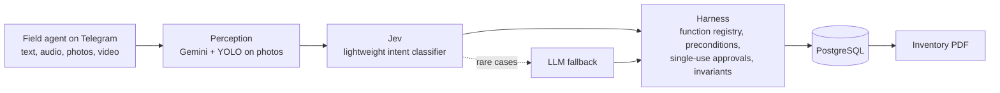

# Natalia Remolina

AI and data engineer and Engineering Physics student at Universidad Nacional de Colombia (Medellín).
I build and operate AI systems in production. My goal is to move toward physical AI and robotics:
training agents in simulation with NVIDIA Isaac Lab, reinforcement learning and computer vision. I am
also interested in high-performance computing and quantum computing applied to AI.

[LinkedIn](https://www.linkedin.com/in/natalia-patricia-remolina-rodriguez-1327a8220/) · nremolina@unal.edu.co

---

## About

Most of my work is on conversational and voice agents. I gather requirements with the client, design
the knowledge base and the guardrails, deploy the service and measure how it behaves once real users
arrive. I currently maintain four agents in production for four clients, which handle more than
1,000 messages and about 100 voice calls a month.

I came to engineering from project management. I hold a technologist degree from SENA, worked as a
Product Owner and, before that, as a field data analyst for the municipality of Yopal. That path
taught me to start from the problem and to report results with numbers I can defend.

## Research interests

- **Physical AI and robotics.** This is where I want to focus next: robot learning in simulation
  with NVIDIA Isaac Sim and Isaac Lab, reinforcement learning for control, and computer vision for
  perception, with the long-term question of how policies trained in simulation transfer to real
  robots. My starting point is applied computer vision (YOLO in a production agent, CNNs for image
  classification, real-time object detection); reinforcement learning and Isaac Lab are what I am
  learning now.
- **Quantum computing and quantum machine learning.** I am a junior researcher in the QUANTA
  Research and SIMG groups at UNAL and a research assistant at
  [Kat Quantum](https://katquantum.lovable.app/team), where I work on experiments and data
  pipelines. I am co-organizing the [Qiskit Fall Fest 2026](https://katquantum.lovable.app/fall-fest),
  an official IBM Quantum event hosted by UNAL and Kat Quantum. I completed Introduction to Quantum
  Computing (The Coding School, Google Quantum AI scholarship) and I am a student volunteer at IEEE
  Quantum Week 2026 (QCE26). I am interested in how quantum ML methods compare with strong classical
  baselines.
- **High-performance computing for AI.** I received a CyberColombia scholarship for the
  [8th Colombian HPC Summer School](https://cybercolombia.org/summer_school_8/#cybercolombia-scholarship-awardees) (June 2025). I want to strengthen my work on distributed training, GPU acceleration
  and large-scale evaluation, which is also what parallel robot simulation needs.
- **Reliable evaluation of LLM systems.** This is where I have the most hands-on experience: shadow
  mode, non-regression tests and metrics measured on live systems.

## Experience

**AI & Data Engineer, AI and data consultancy, Medellín** (Jan 2026 to present)
- Four production agents (FastAPI, LangGraph, ElevenLabs) integrated with WhatsApp, Twilio, n8n and webhooks.
- Architecture of a property inventory agent, now in pilot with a real estate client (about 40 inventories a month).
- Data pipelines with PySpark on Databricks and Delta Lake; models served on Vertex AI; Docker deployments on AWS and GCP.

**Research Assistant, [Kat Quantum](https://katquantum.lovable.app/team)** (present)
- Experiments and data pipelines for quantum computing and AI research.
- Co-organizer of the [Qiskit Fall Fest 2026](https://katquantum.lovable.app/fall-fest) (IBM Quantum, November 3 to 5, 2026, virtual), hosted by Universidad Nacional de Colombia and Kat Quantum.

**Analyst / Product Owner, AIMEDIC** (Nov 2024 to Nov 2025)
- Requirements for a 50-person team under Scrum and 10 Power BI and Tableau dashboards for senior management.

**Field Surveyor and Data Analyst, Municipality of Yopal** (2017 to 2021)
- SISBEN and OSIGD survey data collection and validation; regression analysis for regional projects.

## Deployment and infrastructure

**VALAI on AWS EC2.** My voice agent for post-operative follow-up runs on an EC2 instance in
us-east-1 with an Elastic IP. The FastAPI service and the MLflow trace viewer run as systemd
services, HTTPS is handled with certbot, and the server publishes its own metrics (`/api/metrics`).
Over the last 50 turns the median time to first token was 992 ms, and the estimated cost is
USD 0.0065 per call. During the challenge the instance went down when the trace viewer exhausted its
memory; I traced it with `journalctl` and fixed it with swap and a `MemoryMax` limit on the service.
The full write-up is in the [final report](https://github.com/NatoRemolina/postop-voice-agent).

In my current role I deploy services with Docker on AWS and GCP, and I use Vertex AI and BigQuery
for model serving and data.

## Case study: property inventory agent

Client work, so the code is private. A field agent uses it on Telegram during a property visit, and
it builds the inventory record in PostgreSQL and PDF from text, audio, photos and video. The main
design decision is that no model writes to the record directly: every action passes through a harness
written in code.

Every change runs first in shadow mode with non-regression tests. On 95 new phrases the classifier
got 84 right, against 69 for the previous rule-based version, with no false confirmations, a median
latency of 262 ms and an estimated cost of about USD 0.0035 per inventory.

## Selected projects

**[VALAI](https://github.com/NatoRemolina/postop-voice-agent)** (2026, individual). Spanish voice
agent that calls post-surgery patients, answers from clinical guidelines with source and page
citations, and escalates to a person when needed. Hybrid RAG with ChromaDB and BM25, Gemini with
automatic fallback to Llama, Random Forest-assisted triage. Tech Sphere Challenge 2026.

**[RetailMind](https://github.com/NatoRemolina/Dataholics-Samsung-Innovation-Campus-2026)** (2026,
team). Third place nationally at the Samsung Innovation Campus hackathon. I handled data cleaning and
model training on 156 weeks of data for 85 customers. With leakage-free features, Ridge reduced sales
MAE from 12.94 to 11.76 and raised R² from 0.06 to 0.47 against the baseline.
[Dashboard](https://giovacode1.github.io/Dataholics).

**[Educational Analytics](https://github.com/Capstone-Tech-Tailors/Analitica-Educativa)** (2026,
team of three). My part was the sentiment model: RoBERTuito fine-tuned on human labels, macro-F1 of
0.646 on the human evaluation, on par with the best public model. The team deployed it on Azure
Container Apps.

**[Credit Risk](https://github.com/Team5RNABI/credit-risk-ml-nn)** (2025, team). Logistic-regression
scorecard against a PyTorch network for probability of default. The interpretable model was better
on test (ROC-AUC 0.79).

**[EPM Conversational Agent](https://github.com/NatoRemolina/Agente-Conversacional-EPM)** (2025).
RAG assistant that checks water-service outages in Medellín and cites the official documents.

**[Real-Time Object Detection](https://github.com/NatoRemolina/roboflow-detector)** (2026). Progressive
web app that runs object detection from a phone camera, deployed on Vercel.

## Tools

- **Languages and data:** Python, SQL, PySpark, Databricks, Delta Lake, PostgreSQL, BigQuery, pandas
- **Machine learning:** PyTorch, scikit-learn, TensorFlow, MLflow, Airflow
- **LLM systems:** LangGraph, LangSmith, RAG (ChromaDB, FAISS, BM25), Gemini, Llama, OpenAI
- **Cloud and deployment:** AWS (EC2, systemd, HTTPS), GCP (Vertex AI), Azure, Docker, Linux
- **Computer vision:** YOLO, CNNs (ResNet, VGG), Roboflow
- **Integrations:** FastAPI, Twilio, WhatsApp, Telegram, ElevenLabs, n8n
- **Currently learning:** NVIDIA Isaac Sim and Isaac Lab, reinforcement learning (PPO and related methods)

## Education and training

- Engineering Physics, Universidad Nacional de Colombia (in progress)
- Advanced Machine Learning and Data Science Diploma, Universidad Nacional de Colombia (until Dec 2026)
- Machine Learning Diploma, Universidad de Antioquia (until Dec 2026)
- Technologist in Project Management, SENA (completed)
- [8th Colombian HPC Summer School](https://cybercolombia.org/summer_school_8/#cybercolombia-scholarship-awardees), CyberColombia scholarship recipient (2025)
- Introduction to Quantum Computing, Google Quantum AI scholarship (2024 to 2025)
- Global Consumer Intelligence, Data Science Program, The University of Tokyo (2025)
- Applications of AI for Anomaly Detection, NVIDIA Deep Learning Institute (2026)

## Awards and service

- Third place nationally, Samsung Innovation Campus hackathon (2026)
- Outstanding Performance Award, Samsung Innovation Campus (2026)
- Co-organizer, [Qiskit Fall Fest 2026](https://katquantum.lovable.app/fall-fest), Universidad Nacional de Colombia and Kat Quantum
- Student Volunteer, IEEE Quantum Week 2026, Toronto

---

Open to AI Engineer, ML Engineer (MLOps) and Data Engineer roles, and to research opportunities in
physical AI and robotics, HPC and quantum AI.
